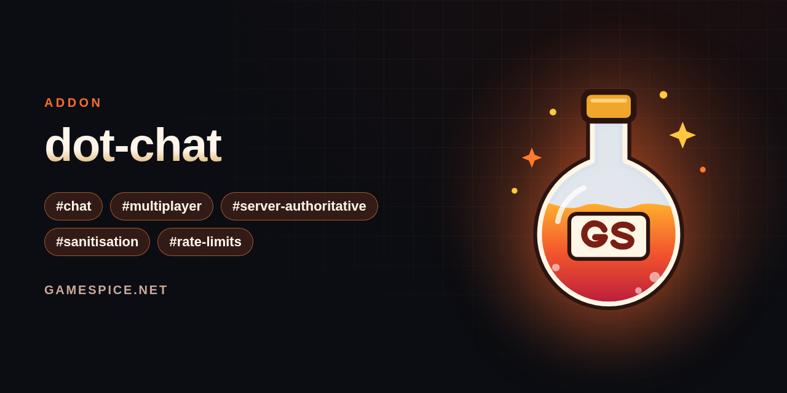

[](https://moddingcommunity.com/a/34-gs-chat)

Text chat for Godot 4.7+ multiplayer games, decided by the server. It gives you channels with an audience rule, cleaning of markup and invisible characters, rate and repeat limits, command prefixes, scrollback, and a backlog for players who join later. Part of the [GameSpice](https://github.com/gamespice-platform) family. It needs only [GameSpice Core](https://github.com/gamespice-platform/core).

GameSpice Chat is a GameSpice addon, MIT licensed, built with Claude Code and checked by a headless self-test (`res://examples/chat_selftest.tscn`). The games in [Zee's Games](https://zeesgames.com) run on live servers and are built on the GameSpice addons, so the text chat players use there is this code.

The server decides who hears a line, what it may contain, and what name is drawn beside it. Chat is the one place where a player puts arbitrary text in front of everyone else, so four things are handled on the server and your game gets a line to draw:

| Risk | What GameSpice Chat does |
| --- | --- |
| Markup (colours, sizes, images, links in a `RichTextLabel`). | Escapes it. |
| Invisible text (zero-width characters, direction overrides). | Removes it. |
| Faked names and prefixes. | The server builds the name and prefix. A client cannot send a pre-formatted line. |
| Wrong audience (team chat reaching the other team). | The router picks the audience from the channel rule. |

## Install

1. Copy `addons/gs_chat/` and `addons/gs_core/` into your project.
2. Enable gs-chat in *Project > Project Settings > Plugins*.

[GameSpice Moderation](https://github.com/gamespice-platform/moderation) is optional. When it is present, its gags apply with no wiring: the router asks whatever is registered as `gs_mute_source`, and neither addon names the other.

## Quick start

On the server:

```gdscript
var router := GSChatRouter.new()

router.peers_fn = func() -> PackedInt32Array: return server.peer_ids()
router.name_fn  = func(peer: int) -> String: return server.session_of(peer).name
router.key_fn   = func(peer: int) -> String: return server.session_of(peer).uid
router.team_fn  = func(peer: int) -> StringName: return game.team_of(peer)
router.send_fn  = func(wire: Dictionary, to: PackedInt32Array) -> void:
    for peer in to:
        link.rpc_id(peer, "chat_line", wire)

add_child(router)

# When a client says something:
var res := router.submit(peer, &"all", text_they_typed)
if not res.ok:
    link.rpc_id(peer, "chat_notice", res.error.message)
```

On the client:

```gdscript
var chat := GSChatClient.new()
chat.channels = [GSChatChannel.everyone(), GSChatChannel.team()]
chat.send_fn = func(text: String, channel: StringName) -> void:
    link.rpc_id(1, "chat_say", String(channel), text)
chat.message_received.connect(func(m: GSChatMessage, _c: StringName) -> void:
    log_label.append_text(GSChatFormat.line(m, chat.channel(m.channel)) + "\n"))
add_child(chat)

# From your input box:
var res := chat.compose(chat.active_channel, entry.text)
if not res.ok:
    hud.flash(res.error.message)
```

That gives you everybody chat, team chat, whispers, `/me`, rate and repeat limits, escaping, scrollback and a backlog.

## Channels

A channel is a `Resource` with an audience rule.

| Scope | Who hears it |
| --- | --- |
| `EVERYONE` | All players. |
| `TEAM` | The sender's team. |
| `RADIUS` | Players within a distance (proximity chat). |
| `DIRECT` | One player (whispers). |
| `MEMBERS` | A group the host answers for, through `membership_fn` (a clan, the dead, admins). |

```gdscript
var proximity := GSChatChannel.make(&"near", "Nearby", GSChatChannel.Scope.RADIUS)
proximity.radius = 20.0
router.add_channel(proximity)
```

Membership is asked, never stored. Which team a peer is on is a fact your game owns, and a second copy goes stale.

For party chat, mark the channel `grouped` and give the router a `group_fn`. A line then reaches only the sender's party. `membership_fn` cannot do this on its own, because it is not told who is speaking.

```gdscript
router.add_channel(GSChatChannel.group(&"party", "Party"))
router.group_fn = func(peer: int, _channel: StringName) -> StringName:
    return StringName(parties.party_of(uid_of(peer)))   # "" for nobody's party
```

Someone in no party reaches only themselves. A grouped channel with no `group_fn` reaches nobody. A line from the server reaches everybody who is in a party.

## Rules and limits

These are defaults. Each is a property you can change on `GSChatRules` or `GSChatChannel`.

| Setting | Default | What it does |
| --- | --- | --- |
| `max_length` | 256 | Longest line. `refuse_over_length` (default on) refuses a longer line; off cuts it. |
| `rate_per_minute` | 20 | Lines per minute per player. A channel's `rate_cost` (default 1) makes a line cost more or less. |
| `duplicate_window_sec` | 8 | Refuses the same line repeated inside this window. 0 turns it off. |
| `history_limit` (channel) | 200 | Lines kept per channel. 0 keeps none. |
| `backlog` (channel) | 0 | Past lines handed to a joining player. Channels other than `EVERYONE` default to none, because a backlog of team chat is a leak. |

The inspector sliders limit some of these (for example `max_length` to 4096 and `backlog` to 256). Set the property from code to go beyond them.

## Commands

A line starting with `!` or `/` is never broadcast. It arrives as a signal.

```gdscript
router.command_entered.connect(func(peer, command, args, raw):
    if command == "rtv":
        router.claim_command()
        vote.rock_the_vote(peer))
```

This is how [GameSpice Server](https://github.com/gamespice-platform/server)'s chat commands and GameSpice Vote's `!rtv` reach a player without either addon knowing this one exists.

## Drawing it

GameSpice Chat ships no art. [GameSpice UI](https://github.com/gamespice-platform/ui)'s `GSChatWindow` is a ready window (a log, a line to type in, and a key that opens it). Point its `submitted` at `GSChatClient.compose` and feed what arrives back through `add_message`.

## Is the line reaching the site?

`GSChatRelay.is_carrying()` tells you whether a line typed in game reaches the site right now. It is true only when the relay is started, enabled, sending game chat and holding a credential. gs-server hands that answer to each joining player, so a client can decide whether to draw its own chat box or leave it to the embedding page. See [docs/relay.md](docs/relay.md).

More: [docs/design.md](docs/design.md), [docs/history.md](docs/history.md).

## Test

```bash
godot --headless --path . --import
godot --headless --path . res://examples/chat_selftest.tscn
```

The self-test is offline and exits non-zero on any failure.

## Used by

### Zee's Games

Zee's Games is a collection of games I made on GameSpice, for demonstration and for fun. They show what the platform can do, and they run on live servers you can join. Anybody can create games on GameSpice, and each addon is its own repository and can be used separately from the games and from the rest of GameSpice.

Every game in the collection vendors it:

- [Fatal Contact](https://zeesgames.com/fatal-contact)
- [Airdrift](https://zeesgames.com/airdrift)
- [Playlot](https://zeesgames.com/playlot)
- [Hungario](https://zeesgames.com/hungario)
- [Buses From Hell](https://zeesgames.com/buses-from-hell)
- [Smash Copter](https://zeesgames.com/smash-copter)
- [Zombie Zone](https://zeesgames.com/zombie-zone)
- [Hide n Seek](https://zeesgames.com/hide-n-seek)
- [Prop Hunt](https://zeesgames.com/prop-hunt)
- [Murder Mystery](https://zeesgames.com/murder-mystery)
- [Deathrun](https://zeesgames.com/deathrun)
- [Wipeout](https://zeesgames.com/wipeout)
- [Dangerous Delivery](https://zeesgames.com/dangerous-delivery)
- [Look At Me](https://zeesgames.com/look-at-me)

The whole collection is at [zeesgames.com](https://zeesgames.com).

## Licence

MIT. See [LICENSE](LICENSE). Only the TMC back-end web infrastructure is not open source.
